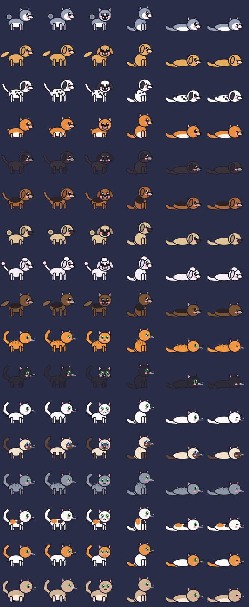

# ❄ Desktop Snow

**English** | [Türkçe](README.tr.md)

Winter effects for your Windows desktop. Snow and other weather fall onto your open windows and the taskbar, and pile up there. Characters and animals wander around the screen. Clicks go through to the windows underneath, so the effects never get in your way.

## Install and run

1. You need **Python 3**. Get it from [python.org](https://www.python.org), and tick **"Add to PATH"** during setup.
2. Double-click **`Desktop Snow.bat`** in the folder.
   - On first launch it installs the needed packages (`pygame-ce`, `pillow`) by itself. This needs an internet connection.
   - It creates a **`Desktop Snow.lnk`** shortcut with a snowflake icon next to it. From then on you can start the app from this shortcut. You can copy it to the desktop or pin it to the taskbar.
3. If you move the folder somewhere else, run the `.bat` once and the shortcut updates to the new location.

Only one copy of the app runs at a time. If you try to open it while it's already running, you get an "already running" message.

## Packaging to move it

Double-click **`paketle.bat`**. It creates **`Desktop Snow.zip`** in the same folder, including your settings. Move the zip wherever you like, extract it and run `Desktop Snow.bat`.

## Shortcuts

| Key | Action |
|---|---|
| `Ctrl+Alt+S` | Show / hide the panel |
| `Ctrl+Alt+E` | Switch to the next effect |
| `Ctrl+Alt+Q` | Quit (settings are saved) |

While the panel is hidden, click the **snowflake icon** in the bottom-right tray to open it. Right-click the icon for a menu.

## Features

- **Effects:** snow, leaves, sakura, rain, fireflies, shooting stars
- **Piling up:** Snow builds up on top of windows and on the taskbar.
  - Shake a window and the snow on it falls off.
  - You can push snow around with the mouse.
- **Decorations:** Christmas trees and snowmen. They can pop up small and grow.
- **Visitors:**
  - **Yeti:** Stomps on snowmen and trees, and roars.
  - **Snowplow:** Clears the snow off the taskbar.
  - **Gift train:** A train with elves arrives and drops off a tree or a snowman.
- **Animals:**
  - 9 dog breeds and 8 cat breeds.
  - They wander, sit, lie down and sleep, look at the screen, shiver in the cold, jump and play, and now and then walk off the screen.
  - They push and kick up snow as they walk.
- **Screens:** Choose per monitor whether the effect is shown. You can also set separately whether snow falls in front of apps or only on the desktop.
- **Chaos mode:** Shuffles the settings randomly at set intervals.
- **Start with Windows:** There's a switch under *General → "Start with Windows"* in the panel.

## Panel

Everything is set from the panel, and settings are saved automatically to `settings.json`. The panel itself is in Turkish; this table gives the English meaning of each tab.

| Tab | What you can change |
|---|---|
| ✨ General | Effect choice with live preview, pause, start with Windows, quick actions, chaos mode, FPS |
| ❄ Snow | Density, flake size range, speed, wind, piling, shaking off, pushing with the mouse, melting |
| 🎄 Tree / ⛄ Snowman | Spawning on their own, frequency, maximum count, size, growing in, where they appear |
| 👣 Yeti | Frequency, speed, size, what it stomps, eating snow, roaring, stomping |
| 🚜 Snowplow | Frequency, how much snow it takes to show up, speed, size, what it runs over |
| 🚂 Train | Frequency, speed, size, what it brings, how long it waits at the stop |
| 🐾 Animals | Number of dogs and cats, breed choice, size (all / dogs / cats), speed, each animation on/off and how often, kicking up snow and how much, tail wagging, breath vapor |
| 🖥 Screens | Show on each monitor, and whether snow falls in front of apps |

## Files

| File | Purpose |
|---|---|
| `Desktop Snow.bat` | Launcher: installs packages, creates the shortcut, opens the app |
| `paketle.bat` | Builds a portable zip |
| `desktop_snow.py` | Main app: effects, piling, characters, tray icon |
| `ui.py` | Animated control panel |
| `pet_art.py` | Dog and cat drawings |
| `art_hd.py` | Yeti, snowplow, train, snowman and tree drawings |
| `wallpaper.py` | Old wallpaper feature. Disabled; it only restores your original wallpaper if it changed it before |
| `snow.ico` | App icon |
| `settings.json` | Saved settings. Delete it to go back to the defaults |

## Animals

## Troubleshooting

- **"Python was not found":** Reinstall Python with the "Add to PATH" box ticked.
- **No snow visible:** In the panel's *Screens* tab, check that the monitor is turned on. If snow stays behind your windows, turn on the "snow falls in front of apps" switch.
- **Stuttering:** Lower *General → FPS* or reduce the snow density. A brief hitch the first time a character appears is normal; it's being drawn at that moment.

## License

[MIT](LICENSE) © FikretGezer
