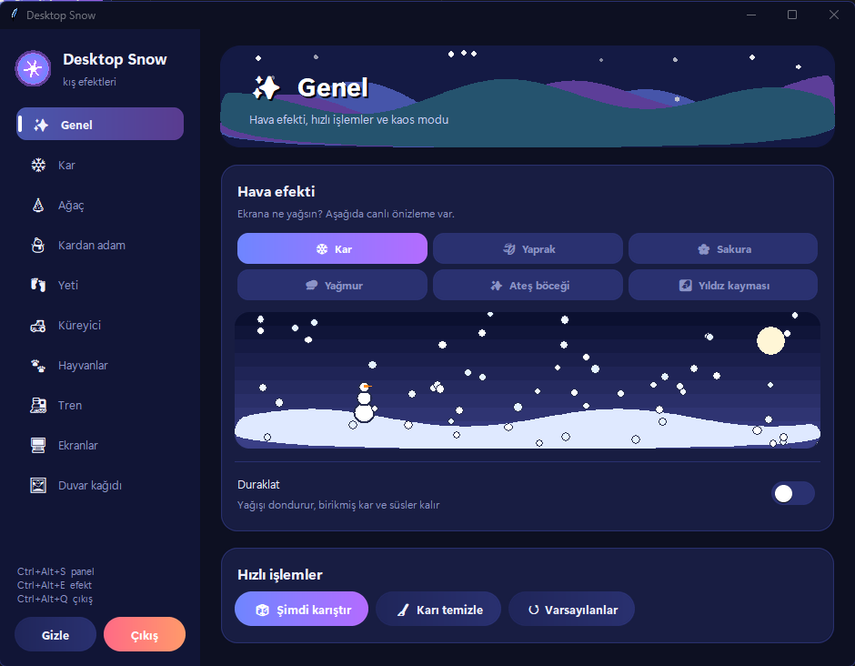
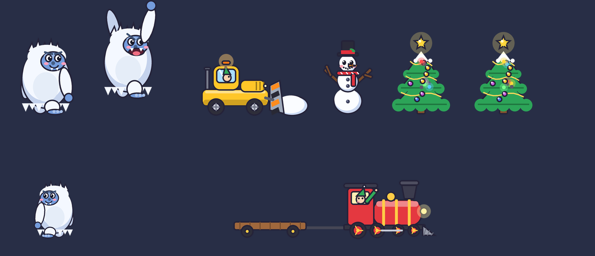

# ❄ Desktop Snow

> Cozy winter effects for your Windows desktop: snow that piles up on windows and the taskbar, a yeti, a snowplow, a gift train and wandering cats & dogs. *(Docs in Turkish.)*

Windows masaüstü için kış efektleri. Kar ve diğer yağışlar, açık pencerelerin ve görev çubuğunun üstüne düşer, orada birikir. Ekranda dolaşan karakterler ve hayvanlar vardır. Tıklamalar alttaki pencerelere gider, yani efektler hiçbir işini engellemez.

## Kurulum ve çalıştırma

1. Bilgisayarda **Python 3** yüklü olmalı. [python.org](https://www.python.org) adresinden indirebilirsin. Kurarken **"Add to PATH"** kutusunu işaretle.
2. Klasördeki **`Desktop Snow.bat`** dosyasına çift tıkla.
   - İlk açılışta gerekli paketleri (`pygame-ce`, `pillow`) kendisi kurar. Bunun için internet gerekir.
   - Yanına kar tanesi simgeli bir **`Desktop Snow.lnk`** kısayolu oluşturur. Bundan sonra uygulamayı bu kısayoldan açabilirsin. Kısayolu masaüstüne kopyalayabilir ya da görev çubuğuna sabitleyebilirsin.
3. Klasörü başka bir yere taşırsan bir kere `.bat` dosyasını çalıştır, kısayol yeni yere göre güncellenir.

Uygulama aynı anda sadece bir kez açılır. Zaten açıkken tekrar açmaya çalışırsan "zaten çalışıyor" uyarısı çıkar.

## Taşımak için paketleme

**`paketle.bat`** dosyasına çift tıkla. Aynı klasörde **`Desktop Snow.zip`** oluşur, içinde ayarların da vardır. Zip'i istediğin yere taşı, çıkart ve `Desktop Snow.bat` dosyasını çalıştır.

## Kısayollar

| Tuş | İşlev |
|---|---|
| `Ctrl+Alt+S` | Paneli aç / gizle |
| `Ctrl+Alt+E` | Sıradaki efekte geç |
| `Ctrl+Alt+Q` | Çıkış (ayarlar kaydedilir) |

Panel gizliyken sağ alttaki **kar tanesi simgesine** tıklayınca panel açılır. Simgeye sağ tıklayınca menü çıkar.

## Özellikler

- **Efektler:** kar, yaprak, sakura, yağmur, ateş böceği, yıldız kayması
- **Birikme:** Kar pencerelerin üstünde ve görev çubuğunda birikir.
  - Pencereyi sallarsan üstündeki kar dökülür ve aşağıya düşer.
  - Fareyle karı itebilirsin.
- **Süsler:** Yılbaşı ağaçları ve kardan adamlar. Küçük çıkıp büyüyebilirler.
- **Ziyaretçiler:**
  - **Yeti:** Kardan adamları ve ağaçları ezer, kükrer.
  - **Kar küreyici:** Görev çubuğundaki karı temizler.
  - **Hediye treni:** Elfli bir tren gelir ve ağaç ya da kardan adam bırakır.
- **Hayvanlar:**
  - 9 köpek türü ve 8 kedi türü var.
  - Dolaşırlar, otururlar, yatıp uyurlar, ekrana bakarlar, üşüyüp titrerler, zıplayıp oynarlar, arada ekrandan çıkıp giderler.
  - Yürürken karı iter ve savururlar.
- **Ekranlar:** Her ekran için efektin gösterilip gösterilmeyeceğini seçebilirsin. Ayrıca karın uygulamaların önüne mi düşeceğini, yoksa sadece masaüstünde mi görüneceğini ayrı ayrı ayarlayabilirsin.
- **Kaos modu:** Ayarları belirli aralıklarla rastgele karıştırır.
- **Windows ile açılma:** Panelde *Genel → "Windows ile birlikte açılsın"* anahtarı var.

## Panel

Her şey panelden ayarlanır ve ayarlar `settings.json` dosyasına otomatik kaydedilir.

| Sekme | Neler ayarlanır |
|---|---|
| ✨ Genel | Efekt seçimi ve canlı önizleme, duraklat, Windows ile açılma, hızlı işlemler, kaos modu, FPS |
| ❄ Kar | Yoğunluk, tane boyu aralığı, hız, rüzgâr, birikme, sallayınca dökülme, fareyle itme, erime |
| 🎄 Ağaç / ⛄ Kardan adam | Kendiliğinden çıkma, sıklık, en fazla sayı, boyut, büyüyerek çıkma, nerede çıkacağı |
| 👣 Yeti | Sıklık, hız, boyut, neleri ezeceği, kar yemesi, kükreme, tepinme |
| 🚜 Küreyici | Sıklık, gelmesi için gereken kar miktarı, hız, boyut, neleri ezeceği |
| 🚂 Tren | Sıklık, hız, boyut, ne getireceği, durakta bekleme süresi |
| 🐾 Hayvanlar | Köpek ve kedi sayısı, tür seçimi, boyut (hepsi / köpek / kedi), hız, her animasyonun açık-kapalı durumu ve sıklığı, karı dağıtma ve ne kadar dağıttıkları, kuyruk sallama, nefes buharı |
| 🖥 Ekranlar | Her ekranda gösterme ve karın öne düşüp düşmeyeceği |

## Dosyalar

| Dosya | Ne işe yarar |
|---|---|
| `Desktop Snow.bat` | Başlatıcı: paketleri kurar, kısayolu oluşturur, uygulamayı açar |
| `paketle.bat` | Taşınabilir zip yapar |
| `desktop_snow.py` | Ana uygulama: efektler, birikme, karakterler, tepsi simgesi |
| `ui.py` | Animasyonlu kontrol paneli |
| `pet_art.py` | Köpek ve kedi çizimleri |
| `art_hd.py` | Yeti, küreyici, tren, kardan adam ve ağaç çizimleri |
| `wallpaper.py` | Eski duvar kağıdı özelliği. Kapalı, sadece daha önce değiştirdiyse orijinal duvar kağıdını geri yükler |
| `snow.ico` | Uygulama simgesi |
| `settings.json` | Kaydedilen ayarlar. Silinirse varsayılan ayarlara döner |

## Hayvanlar

## Sorun giderme

- **"Python bulunamadı":** Python'u "Add to PATH" kutusunu işaretleyerek yeniden kur.
- **Kar görünmüyor:** Panelde *Ekranlar* sekmesinde o ekranın açık olduğunu kontrol et. Kar arkada kalıyorsa "Kar uygulamaların önüne düşsün" anahtarını aç.
- **Takılma oluyor:** *Genel → FPS* ayarını düşür ya da kar yoğunluğunu azalt. Karakterler ilk kez ekrana geldiğinde bir anlık takılma normaldir, o sırada çiziliyorlar.
